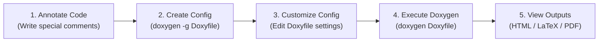

# Doxygen Documentation

Comprehensive reference, concept guides, syntax explanations, configuration mechanics, and assignment walkthroughs for automated source code documentation using **Doxygen**.

---

## Table of Contents

- [Overview](#overview)
- [Concepts Learned](#concepts-learned)
- [Important Terminology](#important-terminology)
- [Installation & Setup](#installation--setup)
- [Doxygen Workflow](#doxygen-workflow)
- [Comment Syntax and Common Tags](#comment-syntax-and-common-tags)
  - [C / C++ / Java Comment Syntax](#c--c--java-comment-syntax)
  - [Documenting Classes](#documenting-classes)
  - [Python Docstrings](#python-docstrings)
  - [Essential Documentation Tags](#essential-documentation-tags)
- [Advanced Features: Grouping & Diagrams](#advanced-features-grouping--diagrams)
- [Configuration and Output Formats (`Doxyfile`)](#configuration-and-output-formats-doxyfile)
- [Best Practices & Version Control](#best-practices--version-control)
- [Doxygen vs. Google Docs](#doxygen-vs-google-docs)
- [Lecture Coverage Tracker](#lecture-coverage-tracker)
- [Assignment-Based Learning](#assignment-based-learning)
- [Key Takeaways](#key-takeaways)
- [References & Resources](#references--resources)

---

## Overview

**Doxygen** is the industry-standard, open-source documentation generator for software projects written in languages such as C, C++, Python, Java, PHP, and C#. It parses specially formatted comments directly embedded in source code files to generate comprehensive, hyperlinked reference manuals in multiple formats, including HTML, LaTeX, PDF, RTF, and XML.

In modern software development, Doxygen bridges the gap between code implementation and developer documentation by ensuring that API specifications remain in sync with the codebase.

---

## Concepts Learned

### Why Documentation Matters
- **Requirement Clarity:** Clarifies architectural design, function contracts, and software specifications.
- **Maintenance & Onboarding:** Significantly reduces time needed for new engineers to understand system internals.
- **Compliance & Auditing:** Provides verifiable records for quality control and regulatory compliance.
- **Knowledge Sharing:** Prevents single-developer knowledge silos across distributed engineering teams.

### Core Capabilities of Doxygen
- **Automated Extraction:** Scans source trees and extracts signatures, classes, modules, and inline docstrings.
- **Cross-Referenced Navigation:** Generates bidirectional hyperlinks connecting declarations, definitions, caller/callee trees, and usage sites.
- **Visual Call & Inheritance Graphs:** Integrates with Graphviz (`dot`) to automatically render inheritance hierarchies, collaboration diagrams, and function call trees.
- **CI/CD Integration:** Builds reference manuals automatically within continuous integration pipelines (e.g., GitHub Actions) to keep documentation evergreen.

---

## Important Terminology

| Term | Definition |
| :--- | :--- |
| **`Doxyfile`** | The primary plain-text configuration file containing key-value pairs defining project settings, input paths, parsers, and output formats. |
| **Special Comment Block** | Distinctive comment syntax (e.g., `/** ... */`, `///`, `/*! ... */`) recognized and parsed by Doxygen. |
| **Documentation Tag / Command** | Semantic markers prefixed by `\` or `@` (e.g., `\brief`, `@param`) indicating metadata fields. |
| **Call Graph** | A visual directed graph illustrating functions invoked by a specific function. |
| **Caller Graph** | A visual directed graph illustrating functions that call a specific function. |
| **Graphviz (`dot`)** | An open-source graph visualization package used by Doxygen to render diagrams. |

---

## Installation & Setup

| Operating System | Installation Command / Method | Verification |
| :--- | :--- | :--- |
| **Windows** | Download binary installer from [doxygen.nl/download.html](https://www.doxygen.nl/download.html) | `doxygen --version` |
| **macOS** | `brew install doxygen` | `doxygen --version` |
| **Linux (Ubuntu/Debian)** | `sudo apt-get install doxygen` | `doxygen --version` |

> [!NOTE]
> To enable automatic diagram generation, install **Graphviz** as well (`sudo apt-get install graphviz` or `brew install graphviz`).

---

## Doxygen Workflow



1. **Write formatted comments** in your source files using Doxygen comment conventions.
2. **Generate default configuration:**
   ```bash
   doxygen -g Doxyfile
   ```
3. **Customize `Doxyfile`** with your project name, source directories, diagram preferences, and target outputs.
4. **Execute Doxygen:**
   ```bash
   doxygen Doxyfile
   ```
5. **Inspect the generated outputs:**
   - HTML: Open `html/index.html` in any web browser.
   - LaTeX/PDF: Navigate to `latex/` and run `make` (or `pdflatex refman.tex`) to compile the printable PDF manual.

---

## Comment Syntax and Common Tags

### C / C++ / Java Comment Syntax

Doxygen supports multiline comments starting with `/**` or `/*!`, as well as single-line comments starting with `///` or `//!`. Both `\` and `@` can be used interchangeably for tags.

```cpp
/**
 * \brief Brief description of the function.
 *
 * Longer detailed explanation describing the algorithm,
 * edge cases, preconditions, and postconditions.
 *
 * \param x An integer representing the input value.
 * \return Description of the return value.
 */
int myFunction(int x);
```

### Documenting Classes

Class documentation precedes the class declaration, with member methods documented individually:

```cpp
/**
 * \class Car
 * \brief Represents a vehicle object.
 *
 * Details about the class design and lifecycle management.
 */
class Car {
public:
    /**
     * \brief Start the vehicle engine.
     * \return True if ignition succeeds, false otherwise.
     */
    bool startEngine();
};
```

### Python Docstrings

Doxygen extracts Python docstrings formatted with `"""!` or `##`:

```python
def foo(bar):
    """!
    Brief description of foo.
    More details about the function's internal behavior.

    :param bar: Bar parameter description
    :type bar: int
    :return: Computed result
    :rtype: int
    """
    return bar + 1
```

### Essential Documentation Tags

| Tag | Alternative | Purpose | Example |
| :--- | :--- | :--- | :--- |
| `\brief` | `@brief` | Single-sentence summary of the function, class, or module | `\brief Computes Euclidean distance.` |
| `\details` | `@details` | In-depth architectural notes and explanations | `\details Uses the Pythagorean theorem.` |
| `\param` | `@param` | Describes an input or output parameter | `\param[in] radius The circle radius.` |
| `\return` | `\returns`, `@return` | Specifies the return value and meaning | `\return Area as double-precision float.` |
| `\author` | `@author` | Identifies the author or team | `\author Dr. Neeta Nain` |
| `\version` | `@version` | Specifies the version of the API | `\version 1.2.0` |
| `\see` | `@see` | Cross-references related functions or types | `\see Car::stopEngine()` |
| `\note` | `@note` | Highlights critical implementation notes | `\note Thread-safe function.` |
| `\file` | `@file` | Documents a source or header file | `\file math_utils.h` |
| `\class` | `@class` | Documents an explicitly specified class | `\class Car` |

---

## Advanced Features: Grouping & Diagrams

### Logical Member Grouping
Use `//@{` and `//@}` (or `/*@{*/` and `/*@}*/`) to group related constants, functions, or members together in the generated output:

```cpp
//@{
/** Documented group of mathematical constants */
const double PI = 3.141592653589793;
const double E  = 2.718281828459045;
//@}
```

### Automated Graphviz Diagrams
When Graphviz is installed and enabled in `Doxyfile`, Doxygen automatically generates:
- Class inheritance graphs
- Collaboration / dependency diagrams
- Function call graphs (`CALL_GRAPH = YES`)
- Function caller graphs (`CALLER_GRAPH = YES`)

### Custom Embedded Diagrams
Directly embed custom Graphviz or PlantUML diagrams within comments:
- `@dot ... @enddot` for DOT syntax diagrams
- `@startuml ... @enduml` for PlantUML sequence and state diagrams

### Rich Content Integration
- **Markdown Support:** Full support for Markdown headers, lists, links, and code spans inside comments.
- **LaTeX Math:** Embed mathematical equations using `\f$ x^2 + y^2 = r^2 \f$` (inline) or `\f[ ... \f]` (display mode).
- **HTML / Tables:** Standard HTML tags (`<table>`, ``) are parsed into output formats.

---

## Configuration and Output Formats (`Doxyfile`)

Doxygen produces documentation in various target formats controlled by boolean flags in the `Doxyfile`:

```properties
# Project Information
PROJECT_NAME           = "TW_Project"
PROJECT_NUMBER         = "1.0.0"
OUTPUT_DIRECTORY       = "docs"

# Source File Scanning
INPUT                  = src/ include/
RECURSIVE              = YES
FILE_PATTERNS          = *.c *.cpp *.h *.py *.java

# Target Output Formats
GENERATE_HTML          = YES    # Interactive website (default, best for browsing)
GENERATE_LATEX         = YES    # TeX sources for printable PDF manuals
GENERATE_RTF           = NO     # Rich Text Format for Microsoft Word
GENERATE_XML           = NO     # Structured XML for custom parsers/tools
GENERATE_MAN           = NO     # Unix man pages

# Diagram Settings (Graphviz)
HAVE_DOT               = YES    # Use Graphviz dot tool
CALL_GRAPH             = YES    # Generate function call graphs
CALLER_GRAPH           = YES    # Generate function caller graphs
EXTRACT_ALL            = YES    # Document all entities even without doc blocks
```

---

## Best Practices & Version Control

- **Contract over Implementation:** Document the *purpose*, preconditions, and postconditions of an API rather than merely repeating parameter names.
- **Distinct Brief & Details:** Keep `\brief` short and concise; place longer explanations in separate paragraphs or `\details`.
- **Public API Coverage:** Prioritize thorough documentation for all public and exported interfaces, headers, and classes.
- **Consistent Conventions:** Standardize tag sets (`\` vs. `@`) and docstring styles across the repository.
- **Version Control Hygiene:**
  - Store and track `Doxyfile` in the Git repository.
  - Add generated output folders (`html/`, `latex/`) to `.gitignore`.
- **Automated Documentation CI/CD:** Rebuild and deploy documentation automatically on every push via GitHub Pages or internal documentation portals.
- **Code Reviews:** Require API documentation updates alongside code changes during peer pull request reviews.

---

## Doxygen vs. Google Docs

| Feature | Doxygen | Google Docs |
| :--- | :--- | :--- |
| **Primary Purpose** | Code reference manuals & API specifications | Collaborative reports, proposals, meeting notes |
| **Collaboration Style** | Asynchronous / indirect (Pull Requests, code reviews) | Synchronous / real-time concurrent multi-user editing |
| **Rich Media** | Code call graphs, inheritance trees, `@dot` diagrams | Embedded images, built-in drawings, shapes, tables |
| **Primary Outputs** | Static HTML website, LaTeX / PDF, RTF, XML | Web publish, PDF, DOCX, ODT, EPUB, TXT |
| **Best Suited For** | Source code, libraries, SDKs, developer documentation | Project proposals, specifications, policies, reports |

> [!TIP]
> In end-to-end engineering workflows, both tools complement each other: system architecture and user requirements are authored collaboratively in **Google Docs**, while low-level API reference documentation is generated automatically with **Doxygen**.

---

## Lecture Coverage Tracker

| Lecture | Topic / Scope | Status | Source PPT / Materials |
| :-: | :--- | :---: | :--- |
| **Lecture 1** | Introduction to Documentation Tools: Doxygen & Google Docs | Documented | Slides 1–16, 32–33, 36–37 (Dr. Neeta Nain, MNIT Jaipur) |

---

## Assignment-Based Learning

| Assignment | Description | Source Files | Output Files | Notes / Status |
| :--- | :--- | :--- | :--- | :--- |
| **Assignment 7** | Multi-file C++ *Calculation Engine* project (`@mainpage`, `@class`, `@enum`, `@todo`, collaboration & include graphs) | [`Doxyfile`](./assignments/Assignment%207/Doxyfile), [`Logger.h`](./assignments/Assignment%207/Logger.h), [`CalculationEngine.h`](./assignments/Assignment%207/CalculationEngine.h), [`main.cpp`](./assignments/Assignment%207/main.cpp) | [`refman.pdf`](./assignments/Assignment%207/refman.pdf), [`html_screenshot_mainpage.png`](./assignments/Assignment%207/html_screenshot_mainpage.png) | [Assignment 7 README](./assignments/Assignment%207/README.md) (Completed) |

---

## Key Takeaways

1. **Automates Code Documentation:** Doxygen eliminates manual duplication by turning inline comments into hyperlinked documentation.
2. **Visualizes Architecture:** Automatically produces call graphs and inheritance hierarchies via Graphviz.
3. **Integrates with Version Control:** `Doxyfile` stays in Git, while CI/CD automates deployment to GitHub Pages.
4. **Tool Specialization:** Use Doxygen for code-level reference manuals, and word processors like Google Docs for high-level prose and requirements.

---

## References & Resources

- [Official Doxygen Manual](https://www.doxygen.nl/manual/)
- [Doxygen Special Commands Reference](https://www.doxygen.nl/manual/commands.html)
- [Graphviz Documentation](https://graphviz.org/documentation/)
- Book: *Docs for Developers: An Engineer’s Field Guide to Technical Writing* by Jared Bhatti, Sarah Corleissen, Jen Lambourne, David Nunez, and Heidi Waterhouse
- Alternative Open-Source Documentation Tools: [Sphinx](https://www.sphinx-doc.org/), [MkDocs](https://www.mkdocs.org/), [Read the Docs](https://readthedocs.org/)
