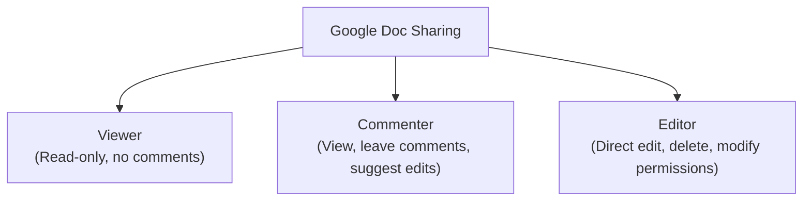

# Google Docs Documentation

Comprehensive reference, document structure guidelines, collaborative workflows, and assignment walkthroughs for technical communication using **Google Docs**.

---

## 📖 Table of Contents

- [Overview](#overview)
- [Concepts Learned](#concepts-learned)
- [Important Terminology](#important-terminology)
- [Document Structure & Semantic Paragraph Styles](#document-structure--semantic-paragraph-styles)
- [Real-Time Collaboration & Review Modes](#real-time-collaboration--review-modes)
- [Version History and Recovery](#version-history-and-recovery)
- [Rich Media, Equations & Code Snippets](#rich-media-equations--code-snippets)
- [Citations and Bibliography](#citations-and-bibliography)
- [Security, Permissions & Sharing Controls](#security-permissions--sharing-controls)
- [Integrations & Script Automation](#integrations--script-automation)
- [Exporting and Publishing Formats](#exporting-and-publishing-formats)
- [Best Practices for Collaborative Documentation](#best-practices-for-collaborative-documentation)
- [Google Docs vs. Doxygen](#google-docs-vs-doxygen)
- [Lecture Coverage Tracker](#lecture-coverage-tracker)
- [Assignment-Based Learning](#assignment-based-learning)
- [Key Takeaways](#key-takeaways)
- [References & Resources](#references--resources)

---

## 🔍 Overview

**Google Docs** is a cloud-native word processor within the Google Workspace ecosystem designed for real-time collaborative document creation, editing, and reviewing. It provides browser-based and multi-device access with automatic continuous saving to Google Drive.

In technical and professional communication, Google Docs is the tool of choice for project proposals, system requirement specifications (SRS), meeting minutes, user documentation, and multi-author research papers that demand seamless live collaboration and cross-functional feedback.

---

## 💡 Concepts Learned

### Core Capabilities of Google Docs
- **Real-Time Concurrent Authoring:** Multi-user editing with synchronized cursors, presence awareness, and in-document chat.
- **Review Workflows:** Dual-mode editing with Suggestion mode (track changes) and granular comment assignment.
- **Continuous Autosave & Milestone Tagging:** Full version audit trail preserving keystroke-level revisions with rollback capability.
- **Document Semantics & Accessibility:** Standardized heading hierarchies driving dynamic Tables of Contents and assistive technologies.
- **Academic Referencing:** Native citation generator for MLA, APA, and Chicago bibliographies.
- **Ecosystem Integration:** Bidirectional linking with Google Drive, Sheets, Slides, and third-party diagramming extensions.

---

## 🏷️ Important Terminology

| Term | Definition |
| :--- | :--- |
| **Semantic Styles** | Structured hierarchy tags (Title, Subtitle, Headings 1–6, Normal Text) defining document architecture. |
| **Suggesting Mode** | A tracked-changes mode where alterations appear as colored proposed edits pending author approval. |
| **Smart Chips** | Interactive in-line elements linked to people (`@name`), dates (`@today`), files, dropdowns, and meeting notes. |
| **Named Version / Milestone** | A user-defined checkpoint in Version History preserving a named snapshot for submission or review. |
| **Table of Contents (TOC)** | An autogenerated navigation index based on Heading levels with clickable anchors or page numbers. |
| **In-Text Citation** | A parenthetical attribution (e.g., `(Bhatti et al., 2021)`) linked directly to a bibliography entry. |

---

## 📑 Document Structure & Semantic Paragraph Styles

### Hierarchy of Styles
To ensure structural consistency, accessible reading, and clean exports, Google Docs relies on semantic styling:

```text
Document Title
├── Subtitle
├── Heading 1 (Major Section)
│   ├── Heading 2 (Subsection)
│   │   ├── Heading 3 (Topic Sub-division)
│   │   └── Normal Text (Body Paragraphs)
```

### Why Semantic Styles Matter
1. **Automated Table of Contents:** Inserting `Insert -> Table of contents` dynamically aggregates all Heading 1, 2, and 3 entries into a linked outline.
2. **Document Outline Pane:** Provides instant sidebar navigation for large technical documents.
3. **Accessibility:** Screen readers rely on semantic tags rather than font size to convey document hierarchy.
4. **Export Fidelity:** Exported PDFs and DOCX files retain structural headings, bookmarks, and navigational metadata.

### Essential Keyboard Shortcuts (Windows)

| Action | Windows Shortcut | Purpose |
| :--- | :--- | :--- |
| **Normal Text** | `Ctrl + Alt + 0` | Resets selection to standard body style |
| **Heading 1 / 2 / 3** | `Ctrl + Alt + 1` / `2` / `3` | Applies semantic heading level |
| **Insert Comment** | `Ctrl + Alt + M` | Highlights selection and opens comment box |
| **Word Count** | `Ctrl + Shift + C` | Displays words, characters, and pages |
| **Page Break** | `Ctrl + Enter` | Pushes following text to a clean new page |
| **Version History** | `Ctrl + Alt + Shift + H` | Opens the revision history sidebar |

---

## 👥 Real-Time Collaboration & Review Modes

### Access Permission Levels

When sharing a document via email invitation or shared link, access permissions should follow the principle of least privilege:



### Collaboration Features
- **Live Cursors:** View real-time collaborator cursors, text highlights, and avatar badges.
- **Suggestion Mode:** Allows contributors to make tracked edits. Document owners/editors can accept (`✓`) or reject (`✗`) each proposed modification individually.
- **Comment Threads & Mentions:** Highlight any text and type `@email` to assign action items to specific team members.
- **In-Doc Chat:** Enables synchronous side discussions without cluttering the document body.

---

## 🕒 Version History and Recovery

Google Docs automatically saves every keystroke to Google Drive, maintaining a comprehensive revision trail.

### Key Version Management Steps
1. **Open Version History:** Go to `File -> Version history -> See version history` (or `Ctrl + Alt + Shift + H`).
2. **Review Revisions:** Click any timestamp to inspect color-coded edits by individual contributors.
3. **Name Document Milestones:** Name critical progress snapshots (e.g., `"Draft 1 - Initial Proposal"`, `"Final Submission - Approved"`) via `File -> Version history -> Name current version`.
4. **Restore Previous Versions:** Select any past snapshot and click **Restore this version** to roll back safely.

---

## 🎨 Rich Media, Equations & Code Snippets

- **Images:** Insert images via `Insert -> Image` (upload from computer, Google Drive, Photos, camera, or web search). Set text wrapping to *In line*, *Wrap text*, or *Break text*.
- **Google Drawings (`Insert -> Drawing`):** Built-in vector canvas to create flowcharts, callout boxes, custom diagrams, and arrows directly within the document.
- **Tables & Lists:** Insert structured tables (`Insert -> Table`) to organize technical specifications and comparisons; use bulleted lists, numbered lists, or interactive checklists for action items.
- **Equations (`Insert -> Equation`):** Provides a mathematical toolbar supporting standard LaTeX commands (`\sqrt`, `\frac`, `\alpha`, `\beta`, `\sum`, `\int`).
- **Code Snippets:** Use monospace fonts (e.g., Courier New, Roboto Mono) or format blocks via `Format -> Paragraph styles -> Borders and shading`. For syntax-highlighted code blocks, integrate extensions or copy formatted blocks.

---

## 📚 Citations and Bibliography

Google Docs includes an integrated referencing tool for academic and technical research:

```text
Tools -> Citations
```

### Referencing Workflow
1. **Select Citation Style:** Choose between **MLA (8th/9th ed.)**, **APA (7th ed.)**, or **Chicago (Author-Date)**.
2. **Add Citation Sources:** Add source metadata for Books, Book Sections, Websites, or Journal Articles.
3. **Insert In-Text Citations:** Place the cursor in the document text and click **Cite** next to the relevant source.
4. **Generate Bibliography:** Click **Insert Works Cited** / **Insert References** to append an automatically formatted bibliography list at the end of the document.
5. **Third-Party Reference Managers:** Connect tools like **Zotero**, **Mendeley**, or **Paperpile** via Chrome extensions and Workspace add-ons for advanced citation synchronization.

---

## 🔒 Security, Permissions & Sharing Controls

- **Granular Link Sharing:** Restrict links to specific individuals, domain-only users (e.g., college domain), or public with a link.
- **Access Expiration:** Set expiration timers on shared links or viewer/commenter permissions.
- **Prevent Download/Copy:** Under sharing settings, uncheck *"Viewers and commenters can see the option to download, print, and copy"*.
- **Admin Restrictions:** Prevent editors from altering sharing permissions or adding new collaborators.
- **Workspace Data Governance:** Protected under Google Workspace cloud encryption at rest and in transit.

---

## 🔌 Integrations & Script Automation

- **Google Workspace Services:** Seamlessly embed linked charts from **Google Sheets**, slide decks from **Google Slides**, and meetings via **Google Meet**.
- **Third-Party Diagramming Add-ons:** Connect **Lucidchart**, **diagrams.net (draw.io)**, or **MathType** directly through `Extensions -> Add-ons`.
- **Project Tracking Integrations:** Link documents to **Trello**, **Asana**, or **GitHub** issues and PRs.
- **Google Apps Script:** Automate repetitive document workflows, template generation, custom mail merges, and bulk report publishing using modern JavaScript (`Extensions -> Apps Script`).

---

## 📤 Exporting and Publishing Formats

Google Docs supports flexible import and export capabilities under `File -> Download`:

| Format | Extension | Common Use Case |
| :--- | :--- | :--- |
| **PDF Document** | `.pdf` | Formal submissions, finalized non-editable reports |
| **Microsoft Word** | `.docx` | Archiving and enterprise collaboration |
| **OpenDocument Format** | `.odt` | Open-source office suites (LibreOffice) |
| **Rich Text Format** | `.rtf` | Cross-platform styled document transfer |
| **Plain Text** | `.txt` | Raw unformatted text extraction |
| **Web Page (HTML, Zipped)** | `.html` | Web publishing and browser rendering |
| **EPUB Publication** | `.epub` | Digital e-reader distribution |

> [!NOTE]
> Documents can also be published live to the web via `File -> Share -> Publish to web` for embedding in websites or generating a public viewing link.

---

## 🎯 Best Practices for Collaborative Documentation

1. **Consistent Style Guide & Templates:** Adopt standardized corporate or academic templates for fonts, margins, and headings.
2. **Strict Heading Discipline:** Never simulate headings using bold text or manual font enlargement; always use semantic `Heading 1`, `Heading 2`, and `Heading 3`.
3. **Assign Clear Collaborative Roles:** Distinguish lead authors (Editors) from reviewers (Commenters) on shared documents.
4. **Document Hygiene Before Export:** Resolve all outstanding comment threads and accept/reject all pending suggestions before generating the final PDF deliverable.
5. **Milestone Version Backups:** Always name milestone checkpoints in Version History prior to major peer reviews or final project handoffs.

---

## ⚖️ Google Docs vs. Doxygen

| Feature | Google Docs | Doxygen |
| :--- | :--- | :--- |
| **Primary Purpose** | General documents, reports, proposals, specifications | Code reference manuals & API specifications |
| **Collaboration Style** | Synchronous / real-time concurrent multi-user editing | Asynchronous / indirect (Pull Requests, code reviews) |
| **Rich Media** | Interactive drawings, tables, images, charts | Code call graphs, inheritance trees, `@dot` diagrams |
| **Primary Outputs** | Web publish, PDF, DOCX, ODT, EPUB, TXT | Static HTML website, LaTeX / PDF, RTF, XML |
| **Best Suited For** | Requirements (SRS), project proposals, meeting notes | Source code, libraries, SDKs, developer documentation |

---

## 📅 Lecture Coverage Tracker

| Lecture | Topic / Scope | Status | Source PPT / Materials |
| :-: | :--- | :---: | :--- |
| **Lecture 1** | Introduction to Documentation Tools: Doxygen & Google Docs | ✅ Documented | Slides 17–33, 36–37 (Dr. Neeta Nain, MNIT Jaipur) |

---

## 📌 Key Takeaways

1. **Seamless Real-Time Collaboration:** Synchronous multi-author editing, suggestions, and threaded comments streamline document review.
2. **Document Structure Powers Automation:** Semantic headings automatically generate navigable Tables of Contents and preserve document outline fidelity.
3. **Safety Through Version History:** Built-in automatic saving and milestone versioning guarantee no loss of intellectual work.
4. **Complete Technical Documentation Suite:** Google Docs handles narrative documents and project proposals, while tools like Doxygen document the implementation codebase.

---

## 🔗 References & Resources

- [Google Docs Help Center](https://support.google.com/docs)
- [Google Workspace Learning Center](https://support.google.com/a/users/answer/9300311)
- [Google Apps Script Documentation](https://developers.google.com/apps-script)
- Book: *Docs for Developers: An Engineer’s Field Guide to Technical Writing* by Jared Bhatti, Sarah Corleissen, Jen Lambourne, David Nunez, and Heidi Waterhouse
